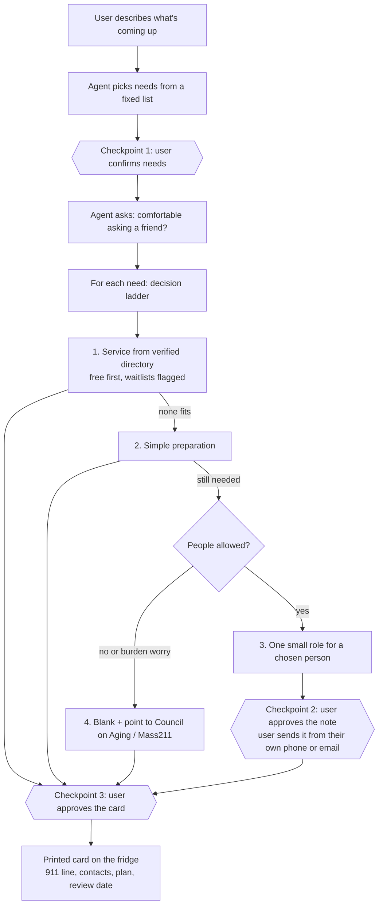

# Workflow

GitHub renders this diagram automatically. Leya can redraw it in Canva for the deck.

## Agent responsibilities
- Turn a conversation into a short list of needs.
- Search the directory and preparations for each need.
- Choose a route for each need following the ladder.
- Draft at most one note, only when allowed.
- Assemble the card from what the user typed.

## Human-in-the-loop decisions
| Checkpoint | What the user decides | Enforced by |
|---|---|---|
| 1 | Which needs to plan for | `confirm_needs` is gated; planning is blocked until confirmed |
| 2 | Whether a note is right, and whether to send it | `draft_helper_note` is gated; no send tool exists |
| 3 | What goes on the card | `make_fridge_card` is gated |

## Architecture
Single agent with eight custom tools in an in-process MCP server. A single agent
is the right fit here: the steps depend on each other and on one conversation,
and splitting them would add cost and failure points without adding value.
